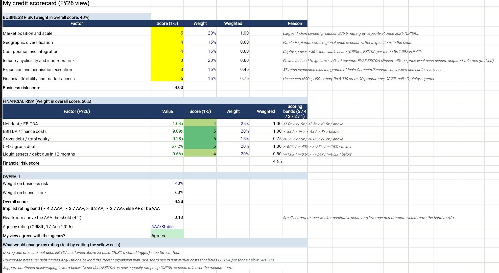
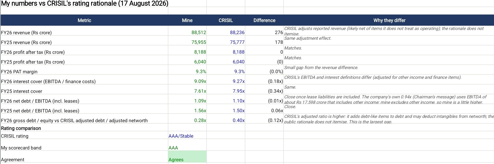
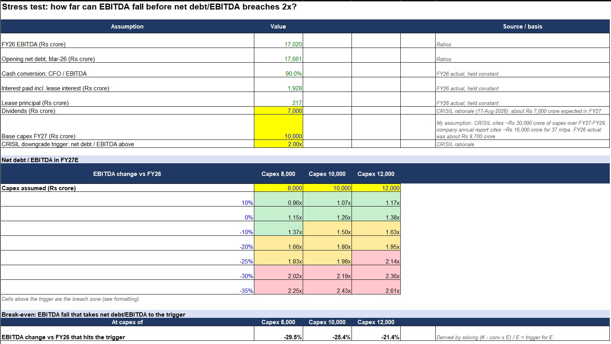
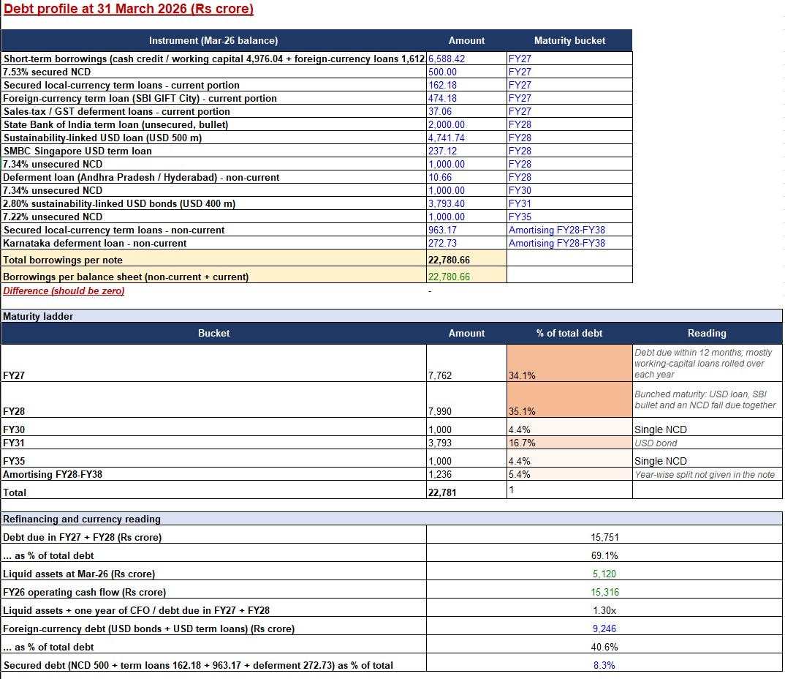
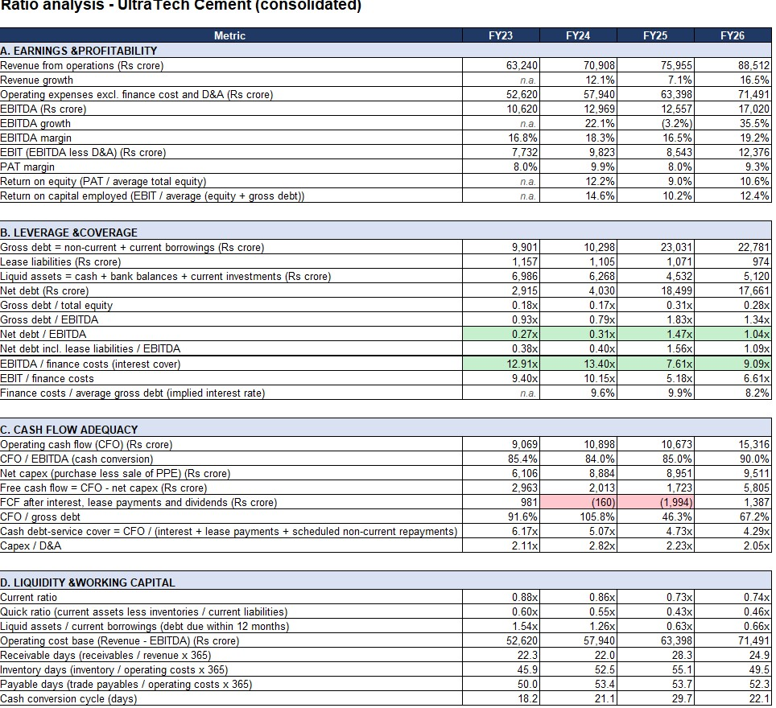
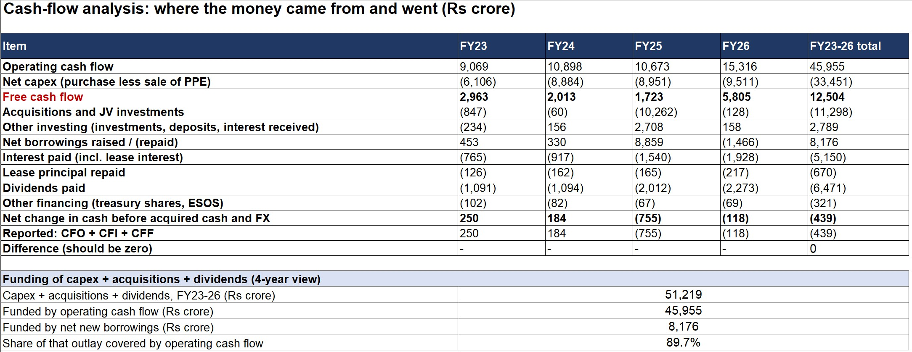
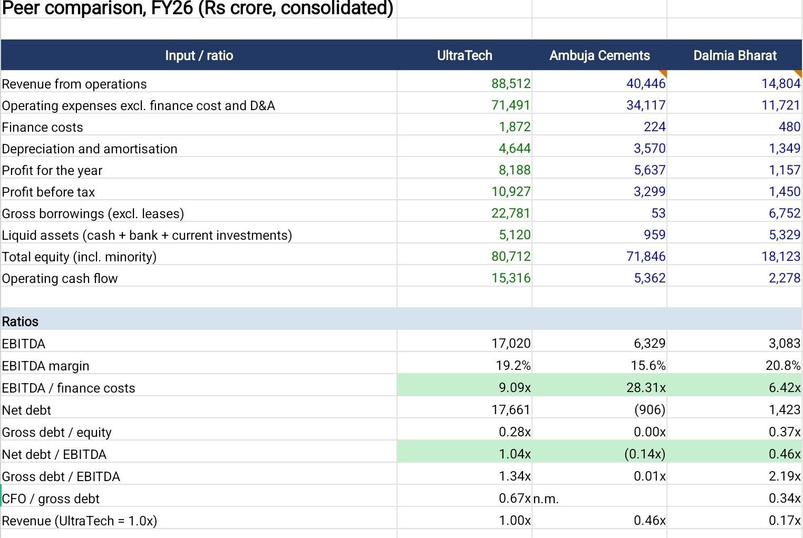
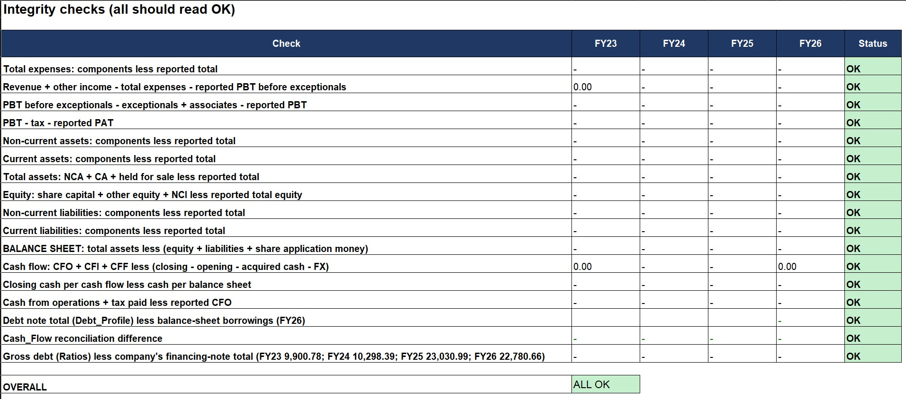

# UltraTech Cement: Credit Analysis and Rating Benchmark

## 1. Project Summary

A credit analysis of UltraTech Cement Ltd, built in Excel from four years (FY23–FY26) of consolidated financial statements. It covers ratio analysis, cash flow, the debt maturity profile, a peer comparison with Ambuja Cements and Dalmia Bharat, and a weighted scorecard that blends business risk (40%) and financial risk (60%) into an implied rating band. A stress test shows how far EBITDA can fall before net debt/EBITDA reaches CRISIL's 2.0x downgrade trigger. The scorecard result (AAA) is benchmarked line by line against CRISIL's rating rationale of 17 August 2026 (AAA/Stable), with each difference explained. A Checks sheet confirms that the source data reconciles to the reported statements.

| Item | Value |
|---|---|
| Company | UltraTech Cement Ltd (consolidated) |
| Period analysed | FY23–FY26 |
| FY26 revenue / EBITDA | Rs 88,512 cr / Rs 17,020 cr (EBITDA margin 19.2%) |
| FY26 net debt / EBITDA | 1.04x (excluding leases), 1.09x (including leases) |
| FY26 interest cover (EBITDA / finance costs) | 9.1x |
| Scorecard result | 4.33 out of 5, implied band AAA |
| CRISIL rating (17 Aug 2026) | AAA/Stable |

**[Excel File Link](https://docs.google.com/spreadsheets/d/1BjZBYzVNPTwsQCFgyDZX7vmOsoQvynSa/edit?usp=sharing&ouid=102967635107932282132&rtpof=true&sd=true)** &ensp; &ensp; _(click to open)_

---

## 2. Screenshots

Save images in an `/screenshots` folder and embed them here.

| File | One-line description |
|---|---|
|  | Credit scorecard: business and financial risk factors, weights, scores and the implied AAA band. |
|  | My metrics side by side with CRISIL's rating rationale, with the reason for each difference. |
|  | Net debt/EBITDA grid across EBITDA declines and capex levels, with the 2.0x downgrade-trigger zone highlighted. |
|  | Debt by instrument and maturity bucket, with the FY27–FY28 refinancing reading. |
|  | Ratio analysis for FY23–FY26: profitability, leverage, cash flow adequacy and liquidity. |
|  | Where the cash came from and where it went over FY23–FY26. |
|  | FY26 peer comparison of UltraTech, Ambuja Cements and Dalmia Bharat. |
|  | Integrity checks sheet showing all checks "OK". |

---

## 3. What Each Sheet Contains

The workbook is `model/UltraTech_cement_final.xlsx`. The nine sheets fall into six groups.

**1. Source Data (`Source Data`)**
Consolidated income statement, balance sheet and cash flow line items for FY23–FY26, entered from the annual reports. Every other sheet is formula-driven from here, so each figure can be traced back to its source.

**2. Ratios and Cash Flow (`Ratios`, `Cash Flow`)**
Ratios cover profitability (EBITDA margin, ROE, ROCE), leverage and coverage (gross and net debt/EBITDA, interest cover), cash flow adequacy (CFO/EBITDA, CFO/debt, debt-service cover) and liquidity (current ratio, cash conversion cycle). The cash flow sheet shows operating cash flow, capex, acquisitions, borrowings, interest and dividends, and how much of the FY23–26 outlay operating cash flow covered (90%).

**3. Debt Profile (`Debt Profile`)**
Borrowings at 31 March 2026 by instrument (NCDs, USD bonds and loans, term loans, working-capital lines) and by maturity year. It highlights that 69% of debt falls due in FY27–FY28, that 41% is in foreign currency, and that only 8% is secured, and it reconciles to the balance sheet.

**4. Peers (`Peers`)**
FY26 comparison of UltraTech with Ambuja Cements and Dalmia Bharat on EBITDA margin, interest cover, gross debt/equity, net debt/EBITDA and CFO/debt, with relative scale.

**5. Scorecard, Stress Test and Rating Compare (`Scorecard`, `Stress Test`, `Rating Compare`)**
The scorecard scores six business-risk factors (qualitative, 1–5) and five financial-risk ratios (banded 1–5) and maps the weighted score to a rating band. It also lists what would trigger a rating change. The stress test shocks EBITDA and capex to find the point at which net debt/EBITDA breaches 2.0x. Rating Compare benchmarks the model's numbers against CRISIL's published rationale.

**6. Checks (`Checks`)**
Seventeen integrity tests across FY23–FY26, including components against reported totals, balance sheet balance, cash flow reconciliation and debt tie-outs. The overall status is "ALL OK".

---

## 4. Limitations

- **The scorecard is my own framework, not an agency methodology.** The scoring bands, factor weights and rating cut-offs (for example AAA at 4.2 or above) are my judgement. The result of 4.33 clears the AAA threshold by only 0.13, so one weaker qualitative score or a modest rise in leverage would move the band to AA+. Agreement with CRISIL shows the framework is reasonable, but it does not prove it would rate other companies correctly.
- **Business-risk scores are qualitative.** The six business-risk factors (market position, cyclicality, execution, and so on) are scored from public information and are subjective.
- **One agency, one date.** I benchmarked against a single CRISIL rationale (17 August 2026). Rating agencies also use management meetings and non-public information that I cannot see.
- **Metric definitions differ from the agency's.** CRISIL adjusts revenue, EBITDA, debt and net worth. For example, my gross debt/equity of 0.28x compares with CRISIL's adjusted 0.40x, and the rationale does not itemise the adjustments. Interest cover is 9.09x against CRISIL's 9.27x.
- **Net debt is shown on two bases.** The scorecard, Ratios and Peers sheets use net debt excluding leases (1.04x), while the comparison with CRISIL includes lease liabilities (1.09x–1.10x). The company's own 0.94x uses an EBITDA that includes other income.
- **Backward-looking.** The analysis uses FY23–FY26 actuals and does not forecast financial statements. The debt sheet is a maturity profile, not a forward projection, and the stress test shocks one year only (FY27).
- **Stress test is simplified.** It holds cash conversion (90%), interest paid, lease principal and dividends (Rs 7,000 cr, per CRISIL) constant, and it shocks only EBITDA and capex. The capex base of Rs 10,000 cr is my assumption, since CRISIL and the company's annual report cite different figures.
- **FY25 is distorted by the acquisition.** The India Cements acquisition (about Rs 10,262 cr of cash out) pushed leverage up in FY25, so year-on-year trends are not like-for-like.
- **Small peer set.** Only two peers are compared, and they differ from UltraTech in scale and business mix. The comparison is a single year (FY26).
- **Public data only.** The model uses published annual reports and CRISIL's public rationale. It is an educational and portfolio project, not a rating or investment advice.

---

## How to Use

1. Download the Excel file from `/model` and open it in Excel.
2. Change the highlighted (yellow) input cells on `Scorecard` and `Stress Test` to see how the rating band and leverage respond.
3. Check `Checks` for "ALL OK" after any change.

## Data Sources

- UltraTech Cement Ltd consolidated annual reports (FY23–FY26).
- CRISIL Ratings rationale for UltraTech Cement Ltd, 17 August 2026.
- Ambuja Cements and Dalmia Bharat FY26 consolidated financials.
